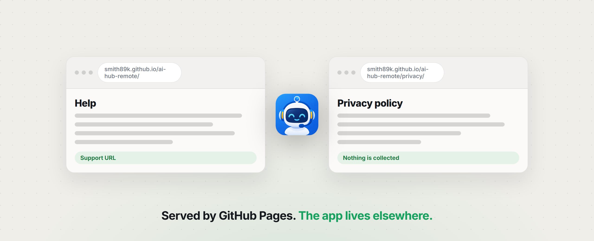

# AI Hub Remote &mdash; public pages

**The help and privacy pages that the App Store listing for AI Hub Remote links to, served by GitHub Pages.**

<picture>
  <source media="(prefers-color-scheme: dark)" srcset="art/banner-dark.png">
  
</picture>

The public pages the App Store links to, served by GitHub Pages from `main`:

- Help (Support URL): https://smith89k.github.io/ai-hub-remote/
- Privacy policy: https://smith89k.github.io/ai-hub-remote/privacy/

The app itself is private and lives elsewhere. Only these pages are here.
